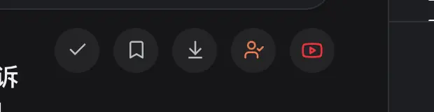
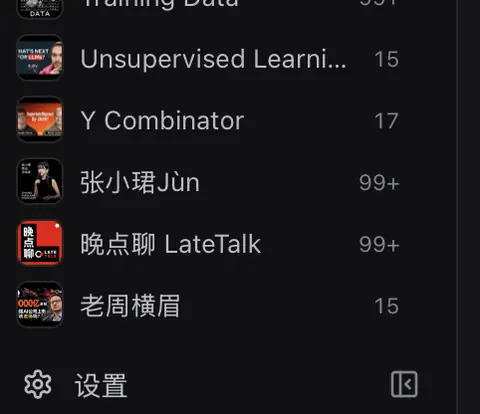
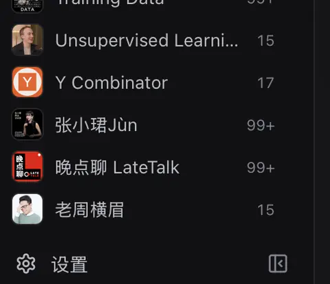
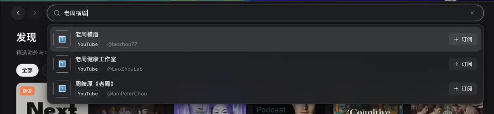
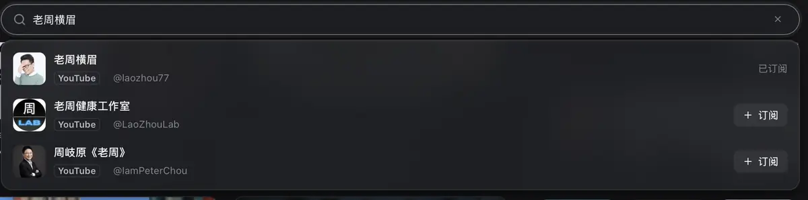

<div align="center">


# SubCast · 声渡

**中文** | [English](#english)

**听懂海外播客和 YouTube：双语字幕、乔木精读、AI 问答，都在一个桌面 App 里。**

Listen to overseas podcasts and YouTube with bilingual subtitles, deep reads and AI Q&A, in one desktop app.

[](https://github.com/joeseesun/subcast/releases/latest)
[](LICENSE)
[](https://subcast.qiaomu.ai)


**[下载最新版](#下载) · [官网](https://subcast.qiaomu.ai) · [更新说明](https://github.com/joeseesun/subcast/releases/latest)**


</div>

## 这是什么

好的海外播客动辄两三个小时，英文听着累，又没有中文字幕。SubCast 把它们变成可以「对照着听、跳着看、直接问」的中文内容：

- 订阅 YouTube 频道、Apple Podcasts、小宇宙或任意 RSS，新的一期自动拉下来。
- 有官方字幕就用官方字幕，没有就在本机识别，再翻译成中文，逐句对照。
- 想快速了解一期讲了什么，看 AI 导读，或者直接问它，回答里的时间戳点一下就跳回原话。

## 下载

| 系统 | 官网直链（始终是最新版） | GitHub |
|---|---|---|
| macOS · Apple 芯片 | [SubCast-mac-apple-silicon.dmg](https://subcast.qiaomu.ai/download/latest/SubCast-mac-apple-silicon.dmg) | [下载](https://github.com/joeseesun/subcast/releases/latest/download/SubCast-mac-apple-silicon.dmg) |
| macOS · Intel | [SubCast-mac-intel.dmg](https://subcast.qiaomu.ai/download/latest/SubCast-mac-intel.dmg) | [下载](https://github.com/joeseesun/subcast/releases/latest/download/SubCast-mac-intel.dmg) |
| Windows 10/11 | [SubCast-windows-setup.exe](https://subcast.qiaomu.ai/download/latest/SubCast-windows-setup.exe) | [下载](https://github.com/joeseesun/subcast/releases/latest/download/SubCast-windows-setup.exe) |
| Linux | [AppImage](https://subcast.qiaomu.ai/download/latest/SubCast-linux.AppImage) · [deb](https://subcast.qiaomu.ai/download/latest/SubCast-linux.deb) · [rpm](https://subcast.qiaomu.ai/download/latest/SubCast-linux.rpm) | [AppImage](https://github.com/joeseesun/subcast/releases/latest/download/SubCast-linux.AppImage) · [deb](https://github.com/joeseesun/subcast/releases/latest/download/SubCast-linux.deb) |

- macOS 安装包已签名并经过 Apple 公证，双击就能打开。不确定是哪种芯片：点左上角苹果菜单 › 关于本机，「芯片」写 Apple M 开头的选 Apple 芯片。
- Windows 安装包还没有代码签名，第一次打开时 SmartScreen 会拦一下，点「更多信息 › 仍要运行」。
- 装好之后会自动更新：新版本在后台下载，重启 App 生效（可在 设置 › 关于 里关闭）。

## 核心能力

| 能力 | 你得到什么 |
|---|---|
| **订阅** | 粘贴 YouTube 频道（@名字 / 频道 / 播放列表）、Apple Podcasts、小宇宙或 RSS，也能按名字搜索全球播客。单个视频或单集可以直接打开。 |
| **双语字幕** | 官方字幕优先；没有就用本机模型识别（默认 Qwen3-ASR 0.6B，约 1 GB，音频不出本机），也可用豆包、硅基流动、Groq、OpenAI 等云端识别。翻译默认免费的谷歌翻译，也能换成自己的模型。双语、中文、原文三种显示。 |
| **共享字幕** | 别人识别过的单集，打开就有字幕，不用再识别一遍。只共享字幕文本，不含音频，可在 设置 › 通用 关闭上传。 |
| **乔木精读** | 精选节目的每一期都有中文精读长文，可以用豆包语音朗读。 |
| **AI 导读** | 一句话总结、时间线、核心观点、原话和「先听这几段」，全部带时间戳。 |
| **AI 问答** | 基于整期文字稿回答，引用可点击跳转；可以带或不带时间戳复制、重新回答、编辑重问、新开对话。 |
| **金句海报** | 选中一句生成海报，5 套主题版式、5 款开源中文字体，带回到原片段的二维码。 |
| **收藏与连播** | 收藏单集，或在节目页「播放全部」，一集结束自动接下一集。 |
| **离线与存储** | 下载单集离线听，设置里能看到占用、打开文件夹、清理。 |
| **四种界面语言** | 简体中文、繁體中文、English、日本語。 |

## 产品巡游

| 首页 | AI 问答 |
|---|---|
|  |  |
| **乔木精读** | **发现** |
|  |  |

<p align="center"></p>

## 从单集订阅

单集页左上角可以订阅这一期所属的频道。订上之后，侧栏用的是 YouTube 频道头像，不是这一期的封面。

| 以前 | 现在 |
|---|---|
|  |  |
|  |  |

## 搜索 YouTube 频道

搜索结果里的频道头像以前经常加载失败，显示成问号。现在头像在本机取好再显示。

| 以前 | 现在 |
|---|---|
|  |  |

## 用自己的模型

AI 导读、问答和可选的字幕翻译，用你自己的模型服务。推荐 DeepSeek，国内直连，一般一期一角钱左右。也预置了硅基流动、Kimi、Claude、OpenAI、OpenRouter、Gemini，以及 Ollama、LM Studio 等本机模型；任何 OpenAI 兼容接口都可以。Key 只存在系统钥匙串里（macOS Keychain / Windows 凭据管理器 / Linux Secret Service）。

## 隐私与边界

- 订阅、字幕、进度和 Key 都保存在本机。
- 用到云端识别、翻译或 AI 时，相关内容会发给你选的服务。
- 共享字幕默认开启：识别好的字幕文本会匿名上传到 `subcast.qiaomu.ai`（带一个随机安装编号，不含音频），可以关闭。
- 在中国大陆看 YouTube 需要代理（设置 › 通用 › 代理，留空走系统代理）；谷歌翻译不可用时会自动换国内中转。
- SubCast 只是播放器和学习工具，节目内容版权属于原作者。

## 开发

本 fork 仅开发 macOS；范围、独立开发配置和启动命令见 [macOS 开发说明](docs/MACOS-DEVELOPMENT.md)。下方保留上游项目的通用说明。

需要 Node.js 22+、Rust（stable）、CMake；Windows 另需 LLVM，Linux 需 `libwebkit2gtk-4.1-dev libdbus-1-dev clang cmake`。

```sh
npm install
npm run tauri dev                                  # 开发
npm run tauri build                                # 打包当前平台
npm run i18n -- --strict                           # 检查四种语言的词条
cd src-tauri && cargo test                         # 单元测试
cd src-tauri && cargo test -- --ignored --nocapture  # 访问真实服务的联网测试
```

<details>
<summary>发版</summary>

- 推送 `v*` 标签后，GitHub Actions 构建 Windows 和 Linux 草稿版本。
- `scripts/release.sh` 在本机为 Apple 芯片和 Intel 分别构建、签名、公证 Mac 版，生成更新清单 `latest.json`；加 `--publish` 上传到官网和 GitHub Release，并建立固定下载链接。
- 共享字幕服务在 `server/`，零依赖 Node.js，部署见 [server/deploy/README.md](server/deploy/README.md)。

</details>

## 架构

Tauri 2（Rust）+ React/TypeScript。网络请求都在 Rust 侧完成（绕开 CORS，统一走代理）；数据存 SQLite；本机识别在子进程里跑，崩溃不影响主程序。详见 [docs/ARCHITECTURE.md](docs/ARCHITECTURE.md)。

本机识别使用 [CrispASR](https://github.com/CrispStrobe/CrispASR)（MIT）运行 Qwen3-ASR，以及 [whisper.cpp](https://github.com/ggerganov/whisper.cpp)（MIT）。部分逻辑（YouTube 字幕获取、翻译提示词、Whisper 幻觉过滤）来自 [乔木剪藏 qiaomu-clipper](https://github.com/joeseesun/qiaomu-clipper)（MIT）。

## 反馈与贡献

- 问题和建议请提 [Issue](https://github.com/joeseesun/subcast/issues)，附上系统版本和复现步骤。
- 欢迎 PR，先读 [CONTRIBUTING.md](CONTRIBUTING.md)。安全问题请按 [SECURITY.md](SECURITY.md) 私下报告。

## 协议

[AGPL-3.0](LICENSE)。可以自由使用、修改和再分发；分发修改版或把它做成网络服务时，必须以 AGPL-3.0 公开完整源码。

## 关于作者

向阳乔木 · [qiaomu.ai](https://qiaomu.ai) · [博客](https://blog.qiaomu.ai) · [乔木推荐](https://tuijian.qiaomu.ai) · X [@vista8](https://x.com/vista8) · 公众号「向阳乔木推荐看」

也欢迎听听我和朋友们的 AI 播客「词元之外 Next Token」：[YouTube](https://www.youtube.com/@nexttokentv?sub_confirmation=1)

---

<a name="english"></a>

# English

**SubCast** is a desktop app (macOS, Windows, Linux) for listening to overseas podcasts and YouTube with bilingual subtitles, AI guides and Q&A.


## Download

Fixed links that always point to the newest version:

| System | From the website | From GitHub |
|---|---|---|
| macOS · Apple silicon | [SubCast-mac-apple-silicon.dmg](https://subcast.qiaomu.ai/download/latest/SubCast-mac-apple-silicon.dmg) | [download](https://github.com/joeseesun/subcast/releases/latest/download/SubCast-mac-apple-silicon.dmg) |
| macOS · Intel | [SubCast-mac-intel.dmg](https://subcast.qiaomu.ai/download/latest/SubCast-mac-intel.dmg) | [download](https://github.com/joeseesun/subcast/releases/latest/download/SubCast-mac-intel.dmg) |
| Windows 10/11 | [SubCast-windows-setup.exe](https://subcast.qiaomu.ai/download/latest/SubCast-windows-setup.exe) | [download](https://github.com/joeseesun/subcast/releases/latest/download/SubCast-windows-setup.exe) |
| Linux | [AppImage](https://subcast.qiaomu.ai/download/latest/SubCast-linux.AppImage) · [deb](https://subcast.qiaomu.ai/download/latest/SubCast-linux.deb) · [rpm](https://subcast.qiaomu.ai/download/latest/SubCast-linux.rpm) | [AppImage](https://github.com/joeseesun/subcast/releases/latest/download/SubCast-linux.AppImage) · [deb](https://github.com/joeseesun/subcast/releases/latest/download/SubCast-linux.deb) |

macOS builds are signed and notarized. Windows builds are not code-signed yet: on first launch choose "More info → Run anyway". The app updates itself in the background and applies new versions on restart.

## What it does

- **Subscribe** to YouTube channels, Apple Podcasts, Xiaoyuzhou or any RSS feed, or search podcasts by name.
- **Bilingual subtitles**: official transcripts first; otherwise on-device recognition (Qwen3-ASR 0.6B by default, about 1 GB, audio stays on your computer) or a cloud service. Translated with Google for free, or with your own model.
- **Shared subtitles**: episodes someone already transcribed open with subtitles ready. Only the text is shared, never audio; uploading can be turned off.
- **AI guide and Q&A** with your own model (DeepSeek, Claude, OpenAI, Kimi, OpenRouter, Gemini, Ollama, LM Studio or any OpenAI-compatible API). Answers cite timestamps you can click.
- **Quote posters**, saved episodes with play-all, offline downloads, and four interface languages.

An episode page can subscribe to that episode's channel. The sidebar then uses the YouTube channel picture, not the episode cover.

| Before | After |
|---|---|
|  |  |
|  |  |

YouTube channel pictures in search used to fail and show a question mark. They are now fetched on the computer and shown directly.

| Before | After |
|---|---|
|  |  |

## Privacy

Subscriptions, subtitles, progress and API keys stay on your computer (keys in the system keychain). Cloud recognition, translation and AI send the relevant content to the service you choose. Watching YouTube from mainland China needs a proxy.

## Build from source

Node.js 22+, Rust stable and CMake (plus LLVM on Windows; `libwebkit2gtk-4.1-dev libdbus-1-dev clang cmake` on Linux), then `npm install` and `npm run tauri dev`. See the Chinese section above for tests and releases.

## License

[AGPL-3.0](LICENSE). Use, modify and redistribute freely; if you distribute a modified version or run it as a network service, you must release the complete source under AGPL-3.0.

Made by [Qiaomu](https://qiaomu.ai) · X [@vista8](https://x.com/vista8)
